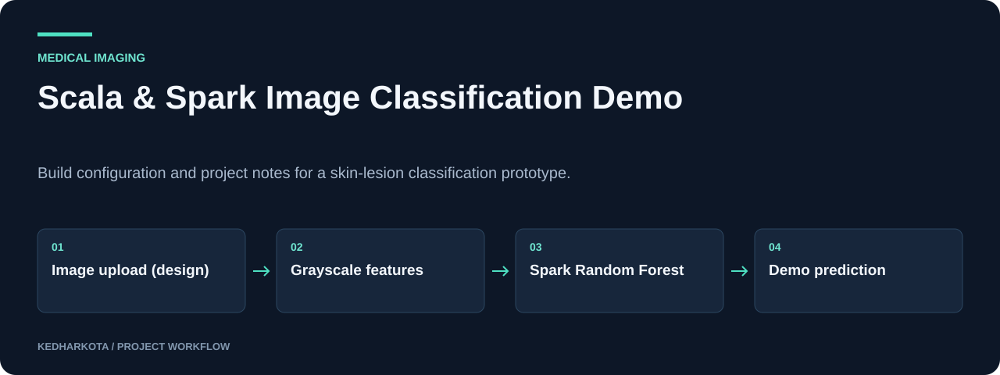

# Scala & Spark Image Classification Demo

Build configuration and project notes for a skin-lesion classification prototype.

**Scala · Play Framework · Apache Spark · MLlib · sbt**

[](https://github.com/kedharkota/Skin-Cancer-Detection-using-SCALA/actions/workflows/docs.yml)

[Overview](#overview) · [Getting started](#getting-started) · [Repository guide](#repository-guide) · [Reproducibility](docs/REPRODUCIBILITY.md)

<p align="center">
  
</p>

[Open full-size visual](docs/assets/overview.svg)

*Explanatory workflow diagram based on the committed project materials.*

## Project at a glance

| Detail | Project information |
| --- | --- |
| **Focus** | Scala and Spark application design and build materials |
| **Start here** | [COMPLETE_TECHNOLOGY_SUMMARY.md](COMPLETE_TECHNOLOGY_SUMMARY.md) |
| **Run mode** | Build/configuration archive; full application source is absent |
| **Explore** | Dependency inventory, demo-model design, and setup notes |

## Overview

A Scala big-data application project described as a web interface for classifying uploaded skin-lesion images. The repository currently publishes the sbt build, launcher scripts, and technology/troubleshooting notes. The application source directories referenced by those notes are absent from the committed tree.

## What this project includes

- Build configuration declaring Scala 2.13.10, Play 2.8.20, Spark 3.4.1, and Hadoop 3.3.6.
- Notes describing 64×64 grayscale features and a Spark MLlib Random Forest.
- PowerShell/batch scripts for environment setup and local/standalone launch attempts.
- Hadoop RPC, logging, memory, and Java-module troubleshooting notes.

## Getting started

Start by reviewing `build.sbt` and the technology summary. A runnable checkout also needs the missing Play controllers/views, routes, resources, and sbt plugin metadata, including the `PlayScala` plugin definition.

After those source files are restored, use a compatible JDK/sbt installation and reconcile the Java-module flags in the launch configuration before attempting the documented start scripts. A clean checkout cannot currently be built as the full application.

### Required inputs and current constraints

The technology summary explicitly describes a Random Forest trained on synthetic examples, rather than a validated medical model. Application source, training data, and real medical checkpoints are absent. The notes contain inconsistent Java-version assumptions that need resolution against a tested environment.

## Repository guide

| File | Purpose |
| --- | --- |
| [build.sbt](build.sbt) | Declared Scala and JVM dependencies. |
| [.jvmopts](.jvmopts) | JVM configuration. |
| [COMPLETE_TECHNOLOGY_SUMMARY.md](COMPLETE_TECHNOLOGY_SUMMARY.md) | Architecture and demo-model description. |
| [NO_PRETRAINED_MODEL_SOLUTION.md](NO_PRETRAINED_MODEL_SOLUTION.md) | Synthetic/demo model explanation. |
| [SPARK_STANDALONE_SETUP.md](SPARK_STANDALONE_SETUP.md) | Standalone Spark notes. |
| [start-app.ps1](start-app.ps1) | PowerShell launcher. |
| [run-standalone.ps1](run-standalone.ps1) | Standalone launch helper. |
| [CONNECTION_ERROR_FIXED.md](CONNECTION_ERROR_FIXED.md) | Recorded connection troubleshooting. |

## Results and project status

The repository supports an architectural description and dependency inventory, not an independently runnable or clinically evaluated classifier. The workflow image represents the design described in the committed notes. No application screenshot or diagnostic accuracy is claimed.

## Next steps

- Commit the complete Play application and plugin configuration.
- Publish a tested JVM environment and replace synthetic demo training with a documented research dataset before reporting medical performance.

## Documentation maintenance

<details>
<summary>Run documentation checks and maintain visuals</summary>

Local documentation links and image headers are checked on pull requests and relevant pushes by the [documentation workflow](.github/workflows/docs.yml). Run the same check locally:

```bash
python tools/check_docs.py
```

See the [reproducibility guide](docs/REPRODUCIBILITY.md) for evidence, missing artifacts, and visual-source notes. The check validates documentation files; it does not train models or certify application behavior.

</details>

## Explore related projects

- [Cardiac Ultrasound Segmentation](https://github.com/kedharkota/-Heart-Murmur-)
- [Healthcare Recommendation Research Prototype](https://github.com/kedharkota/Healthcare-Recommendation-System)

---

[More projects by kedharkota](https://github.com/kedharkota?tab=repositories)
